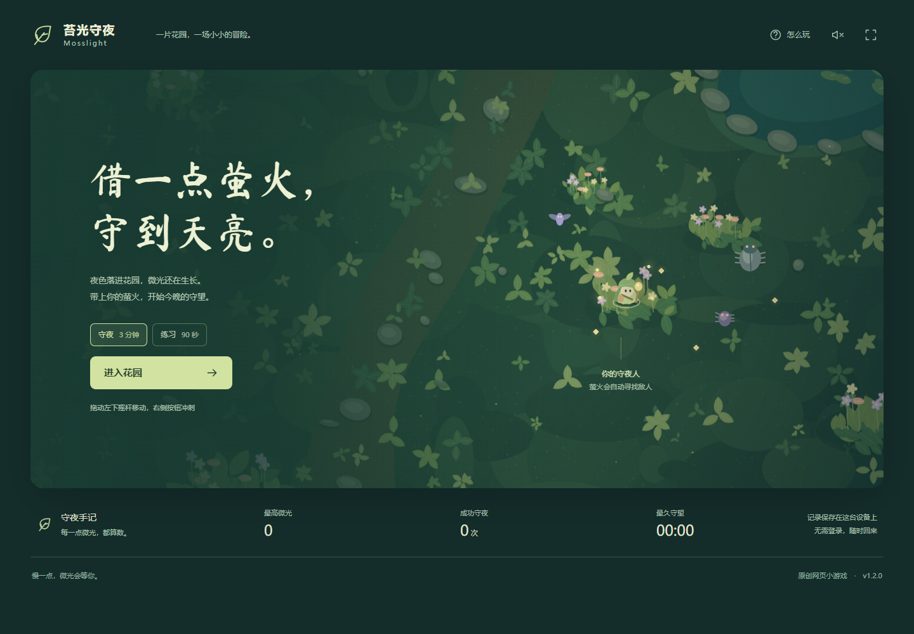

# 苔光守夜 · Mosslight v1.2.0

**借一点萤火，守到天亮。**

一款原创中文网页生存游戏：在月下花园中移动、躲开虫影、拾取微光，组合属于这一夜的能力。萤火自动攻击，存活至黎明即可获胜。

**[在线试玩](https://yunhanhai.github.io/mosslight/)** · [GitHub 源码](https://github.com/yunhanhai/mosslight) · [Gitee 镜像](https://gitee.com/yunhanhai/mosslight)

首轮上手改进：开场拾取金色露光即可选择第一项能力；升级会显示本局真实数值变化；手机改为全屏纵向游玩，也可以在屏幕左侧拖动移动；冲刺能短暂免伤并推开近身虫影，巨蛾会先显示俯冲路线。

v1.2 增加每局一次升级换选、地图角落安全视野和画面外巨蛾方向指示，并修正冲刺方向与后期刷怪数量边界。旧成绩和设置继续保留。



## 立即在本地玩

安装 Node.js 20 或更新版本，在项目目录打开终端：

```powershell
npm start
```

打开 <http://127.0.0.1:4173>。**运行游戏无需先安装 npm 依赖，也不需要账号或外部网络。** Windows 也可以双击 `开始游戏.cmd`。请通过本地服务器打开，不要直接双击 HTML（浏览器会限制本地 ES 模块）。

## 玩法

| 操作        | 电脑               | 手机 / 平板        |
| ----------- | ------------------ | ------------------ |
| 移动        | WASD / 方向键      | 拖动左下摇杆       |
| 冲刺        | 空格               | 右下冲刺按钮       |
| 攻击        | 自动瞄准、自动发射 | 自动瞄准、自动发射 |
| 选择能力    | 鼠标或数字键 1–3   | 点击能力           |
| 暂停 / 继续 | P / Esc / 暂停按钮 | 暂停按钮           |

- **守夜**：180 秒。每 30 秒虫群成长，第 140 秒出现噬光巨蛾。
- **练习**：90 秒，敌人更少、受伤更轻，第 65 秒出现巨蛾，不计入正式手记。
- 拾取金色微光升级，选择伤害、攻速、多发、移速、吸引、生命、护身叶和冲刺等能力。
- 巨蛾是可选挑战，守到天亮即可获胜。
- 手机在屏幕左侧拖动也可移动；落在画面中间的操作不需要特意摸准摇杆。
- 冲刺期间短暂免伤、击退近身虫影并造成一次伤害；巨蛾会显示即将俯冲的方向，注意横向躲开。
- 微光得分 = 驱散数量 × 12 + 拾取经验 × 5 + 守望秒数 × 2；获胜额外 1200 分。
- 声音默认关闭，点击右上角扬声器开启。记录和音效偏好保存在浏览器本地。

## 开发与验证

```powershell
npm ci                 # 仅开发、浏览器测试需要
npm test               # 无头游戏逻辑测试
npm run test:browser   # 桌面与手机浏览器流程
npm run build          # 输出可静态部署的 dist/
npm run preview        # 预览构建结果
```

Windows 本机会优先用已安装的 Edge 跑浏览器测试；其他环境执行 `npx playwright install chromium`。本地监听地址默认为 `127.0.0.1`，局域网真机测试可运行 `npm start -- --host 0.0.0.0`，手机与电脑连接同一网络，再访问电脑局域网 IP 的 4173 端口。

## 目录

```text
index.html / styles.css   页面和适配
src/core.js              可独立测试的确定性游戏逻辑
src/renderer.js          原创 Canvas 场景、角色、敌人与粒子
src/main.js              游戏流程、键盘、触屏和对话框
src/audio.js             Web Audio 合成音效
src/storage.js           本地记录与失败降级
assets/                  图标、标题字体和字体许可
scripts/                 零依赖本地服务器和静态构建
tests/                   单元测试与 Playwright 流程
docs/                    调研、设计、架构、验证、发布与截图
```

## 资料与持续开发

- [为什么选这个方向](docs/RESEARCH.md)
- [游戏设计与数值](docs/GAME_DESIGN.md)
- [架构与维护](docs/ARCHITECTURE.md)
- [测试记录](docs/TESTING.md)
- [开源与部署状态](docs/RELEASE.md)
- [视觉设计规范](DESIGN.md)
- [开发日志](CHANGELOG.md)
- [第三方声明](THIRD_PARTY_NOTICES.md)

## 开源

原创代码、程序化美术和合成音效采用 [MIT License](LICENSE)。标题字体 Ma Shan Zheng 单独遵循 SIL Open Font License 1.1。没有复制参考游戏的代码、图片或音频。

当前不包含后端、在线排行、云存档、付费内容、数据分析或用户追踪。桌面与手机均有自动化浏览器流程，但尚未代表真实 iOS Safari 的人工验证。
